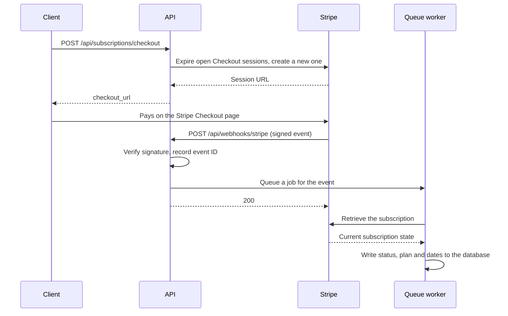

# Laravel Stripe Subscription API

A REST API for SaaS subscription billing on Stripe, built with Laravel 12.

[](https://github.com/sachchin06/laravel-stripe-subscription-api/actions/workflows/ci.yml)
[](LICENSE)


## Overview

Users sign up, pick a plan and pay through Stripe Checkout. The API then keeps a local copy of each subscription in step with Stripe, and uses it to decide which features a user may access and how much they may use.

The interesting part is keeping that local copy correct. Stripe delivers webhooks at least once and in no guaranteed order, so the same event can arrive twice, and an old event can arrive after a newer one. Most of the design below exists to make that harmless.

## Features

- Token authentication with Laravel Sanctum, rate-limited login and registration, and tokens that expire
- Subscribing through Stripe Checkout, with one active subscription per user
- Cancelling at period end, resuming, and changing plan with proration
- Stripe Billing Portal sessions, invoice history and an upcoming-invoice preview
- Signed, idempotent webhook handling, processed by queued jobs
- Plan and price management for admins, with two-way sync between the database and Stripe
- Soft archiving of plans that still have subscribers
- Plan-based feature access and monthly usage limits, enforced by middleware
- OpenAPI (Swagger) documentation
- A Pest test suite that runs without Stripe keys, and a GitHub Actions workflow

## How it works

The API never creates a subscription when the user returns from Checkout. It creates one only when Stripe confirms the payment through a webhook.



The webhook endpoint handles `checkout.session.completed`, `customer.subscription.created`, `customer.subscription.updated`, `customer.subscription.deleted`, `invoice.paid` and `invoice.payment_failed`. Each queued job is tried up to three times, one minute apart.

## Design decisions

**Webhook idempotency.** Stripe may deliver the same event more than once, sometimes at the same moment. Each event ID is inserted into a `stripe_events` table with a unique index before its job is queued, and an event whose ID is already there is skipped. A unique index on `subscriptions.stripe_subscription_id` stops two workers creating the same subscription.

**Out-of-order safety.** A late event must not overwrite newer state, for example a delayed `invoice.paid` reactivating a cancelled subscription. Jobs therefore use the event only to learn which subscription changed, then fetch its current state from the Stripe API and store that. The same step picks up plan changes made in the Billing Portal.

**No Stripe calls inside database transactions.** A rollback cannot undo an HTTP call, so a transaction around a Stripe call can leave the two systems disagreeing. The API writes local rows first, calls Stripe outside any transaction, then stores the returned IDs. Create calls send idempotency keys derived from the local row, so `php artisan stripe:sync to` can safely finish a half-completed create.

**One subscription per user.** Checkout returns 409 if the user already has an active or trialing subscription, and plan changes go through `change-plan` instead. Before creating a Checkout session, the API expires the customer's other open sessions, so two browser tabs cannot both be paid.

**Soft-archived plans.** Deleting a plan with subscribers would lose history and break foreign keys. Archiving such a plan marks it inactive: it disappears from `/api/plans` and accepts no new subscribers, while existing subscriptions keep working. A plan nobody has used is deleted.

**Plan-based feature gating.** Features and monthly limits per plan live in `config/features.php`. The `feature` middleware returns 403 when the plan lacks a feature, and the `usage` middleware returns 429 over the limit and records usage only for successful responses. `GET /api/reports/usage` shows both in use.

## Tech stack

| Area | Choice |
|------|--------|
| Language and framework | PHP 8.3+, Laravel 12 |
| Authentication | Laravel Sanctum 4 |
| Payments | Stripe PHP SDK 18, pinned to API version `2025-10-29.clover` |
| Database | MySQL in development; in-memory SQLite in tests |
| Queue and cache | Laravel database drivers |
| API docs | L5-Swagger (OpenAPI annotations) |
| Testing and style | Pest 4, Mockery, Laravel Pint |
| CI | GitHub Actions on PHP 8.3 and 8.4 |

## Getting started

### Requirements

- PHP 8.3 or later, with `pdo_mysql`, and `pdo_sqlite` for the tests
- Composer
- MySQL
- A Stripe account in test mode
- The [Stripe CLI](https://stripe.com/docs/stripe-cli), logged in with `stripe login`

### Setup

macOS / Linux:

```bash
git clone https://github.com/sachchin06/laravel-stripe-subscription-api.git
cd laravel-stripe-subscription-api
composer install
cp .env.example .env
php artisan key:generate
```

Windows (PowerShell):

```powershell
git clone https://github.com/sachchin06/laravel-stripe-subscription-api.git
cd laravel-stripe-subscription-api
composer install
copy .env.example .env
php artisan key:generate
```

Create an empty MySQL database, then set `DB_DATABASE`, `DB_USERNAME`, `DB_PASSWORD`, `STRIPE_KEY` and `STRIPE_SECRET` in `.env`. Then:

```bash
php artisan migrate --seed          # tables, two plans, and the users below
php artisan stripe:sync to          # creates the plans in your Stripe account and prints the price IDs
php artisan l5-swagger:generate     # API docs at /api/documentation
```

The seeder creates a Basic plan ($20 a month or $200 a year) and a Pro plan ($30 a month or $320 a year), plus two users:

| Email | Password | Role |
|-------|----------|------|
| `test@example.com` | `password` | Normal user |
| `admin@example.com` | `password` | Admin: can manage `/api/products` |

### Run

Use three terminals:

```bash
php artisan serve                   # API on http://localhost:8000
php artisan queue:work              # processes webhook jobs
stripe listen --latest --forward-to http://localhost:8000/api/webhooks/stripe
```

`stripe listen` prints a webhook signing secret (`whsec_...`). Put it in `.env` as `STRIPE_WEBHOOK_SECRET` and restart the first two terminals. Without the queue worker, payments succeed in Stripe but no subscription is stored.

To try a payment, call the checkout endpoint, open the returned `checkout_url`, and pay with the test card `4242 4242 4242 4242`, any future expiry date and any CVC.

### Webhook API version

The code reads webhook payloads in the `2025-10-29.clover` format. Locally, the `--latest` flag on `stripe listen` sends events in the newest API version. For a webhook endpoint created in the Stripe Dashboard, set its API version to `2025-10-29.clover`; otherwise invoice events may not include the subscription ID where the code looks for it.

## Configuration

| Variable | Purpose | Default |
|----------|---------|---------|
| `APP_URL` | Base URL of the API | `http://localhost:8000` |
| `FRONTEND_URL` | Where Stripe returns users after Checkout and the Billing Portal; also the only host (with `APP_URL`) accepted as a portal `return_url` | `APP_URL` |
| `DB_DATABASE`, `DB_USERNAME`, `DB_PASSWORD` | MySQL connection | |
| `QUEUE_CONNECTION` | Queue for webhook jobs | `database` |
| `CACHE_STORE` | Also holds the locks that serialise subscription syncs | `database` |
| `STRIPE_SECRET` | Stripe secret key | |
| `STRIPE_KEY` | Stripe publishable key; the API does not use it, a frontend would | |
| `STRIPE_WEBHOOK_SECRET` | Signing secret for verifying webhooks | |
| `STRIPE_API_VERSION` | Stripe API version sent on every request | `2025-10-29.clover` |
| `STRIPE_CURRENCY` | Currency for new prices | `usd` |
| `SANCTUM_TOKEN_EXPIRATION` | API token lifetime in minutes | `10080` (7 days) |

With no frontend, `FRONTEND_URL` defaults to the API, which serves basic success and cancel pages at `/subscription/success` and `/subscription/cancel`.

## Running tests

```bash
vendor/bin/pest            # 147 tests
vendor/bin/pint --test     # code style check
```

The suite runs real migrations on an in-memory SQLite database and needs no `.env` file, database server or Stripe keys. All Stripe access goes through one class, `StripeService`, which every test replaces with a mock. A test fails if it makes a Stripe call it did not declare.

Webhook tests sign their payloads the way Stripe does, so the real signature check runs. A few unit tests drive the real Stripe SDK against a fake HTTP client to check request headers, URLs and pagination.

The tests cover:
- webhook signatures
- duplicate and out-of-order events
- authentication and admin authorisation
- checkout rules
- cancel, resume and change plan
- billing input validation
- feature gating and usage limits
- product sync
- migrations
- the model and service logic underneath

CI runs the style check and the tests on PHP 8.3 and 8.4 for every push and pull request.

## API overview

All routes except register, login and the webhook need a bearer token. Full request and response details are in the Swagger UI at `/api/documentation` once the app is running.

| Group | Method and path | Description |
|-------|-----------------|-------------|
| Auth | `POST /api/auth/register` | Create an account and receive a token |
| | `POST /api/auth/login` | Receive a token |
| | `POST /api/auth/logout` | Revoke the current token |
| | `GET /api/auth/user` | Current user |
| Plans | `GET /api/plans` | Active plans and their prices |
| Subscriptions | `GET /api/subscriptions` | Current subscription |
| | `GET /api/subscriptions/details` | Live details from Stripe, including the billing period |
| | `POST /api/subscriptions/checkout` | Start Stripe Checkout for a price |
| | `POST /api/subscriptions/cancel` | Cancel at the end of the billing period |
| | `POST /api/subscriptions/resume` | Undo a scheduled cancellation |
| | `POST /api/subscriptions/change-plan` | Switch to another price, with proration |
| Billing | `GET /api/billing/invoices` | Invoice history (`limit` 1 to 100) |
| | `GET /api/billing/upcoming-invoice` | Preview of the next invoice |
| | `POST /api/billing/portal` | Stripe Billing Portal link |
| | `GET /api/billing/usage` | Usage against the plan's limits |
| Reports | `GET /api/reports/usage` | Daily API usage; needs a plan with `advanced_analytics` |
| Products (admin) | `GET /api/products` | All plans, including archived ones |
| | `POST /api/products` | Create a plan with prices |
| | `GET /api/products/{id}` | One plan |
| | `PUT /api/products/{id}` | Update name or description |
| | `DELETE /api/products/{id}` | Archive a plan |
| | `POST /api/products/{id}/prices` | Add a price |
| | `POST /api/products/sync` | Sync with Stripe (`direction`: `from` or `to`) |
| Webhooks | `POST /api/webhooks/stripe` | Stripe event receiver |

## Project structure

```
app/Domains/
├── Auth/           # registration, login, logout
├── Billing/        # Checkout sessions, Stripe customers, invoices, Billing Portal
├── Subscription/   # subscriptions, plans and products, feature gating, usage tracking
├── Webhooks/       # signature checks, event recording, queued jobs
└── Shared/         # StripeService: the single entry point for Stripe API calls
```

Controllers, form requests, middleware and API resources live in `app/Http`, and models in `app/Models`.

## Known limitations and roadmap

Known limitations:
- **Usage limits can be exceeded slightly under concurrency.** The usage check and the usage record are separate steps, so simultaneous requests near the limit can all pass.
- **Duplicate subscriptions are only logged.** If a user still ends up with two paid subscriptions (a session paid in the moment before it is expired), both are stored and a warning is logged. Nothing cancels or refunds the extra one.
- **Idempotency keys last 24 hours at Stripe.** A failed create retried within 24 hours with changed parameters is rejected by Stripe. A retry after 24 hours is no longer protected against duplicates.
- **Unconfigured plans get no gated features.** A plan created through the API that is missing from `config/features.php` gets free-tier usage limits, but no features at all, not even the free-tier ones.

Roadmap:
- Metered, usage-based billing
- Notifications for failed payments
- Immediate cancellation through the API
- A scheduled job that reconciles local subscriptions with Stripe
- Trials and multi-currency prices
- Admin roles beyond a single admin flag
- Alerts when a user has more than one active subscription

## Licence

Released under the [MIT Licence](LICENSE).
